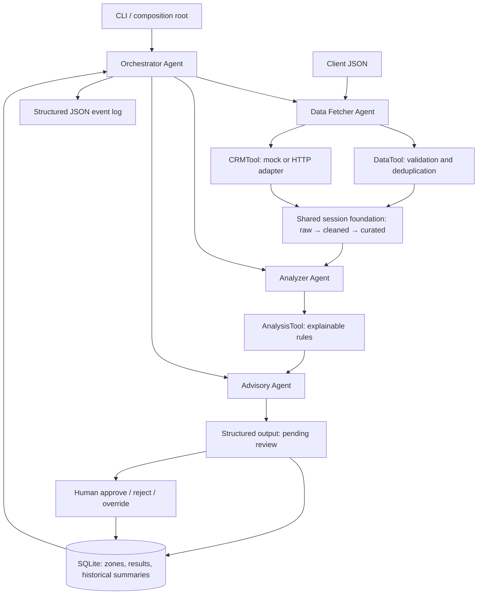

# Wealth Advisor Assistant

A local wealth analysis tool with three specialist agents and a central orchestrator. It ingests client JSON, enriches it with CRM context, detects unusual transactions and risk signals, and produces structured findings for human review.

**Python 3.11+ | standard library only | no API keys | local execution**

## Quick start

From the project root:

```sh
python --version
python -m wealth_advisor run samples/client.json --output data/result.json
python -m unittest discover -s tests -v
```

On Windows, use `py -3` instead of `python` if Python is not on PATH. No dependency installation is needed. An optional isolated environment can be created with `python -m venv .venv`.

The default CRM is an in-process simulated tool. The result is printed as JSON and optionally written to `--output`. The system creates `data/advisor.sqlite3` and `data/execution.jsonl`. Global `--db` and `--log` options go **before** the subcommand:

```sh
python -m wealth_advisor --db data/demo.sqlite3 --log data/demo.jsonl run samples/client.json
```

### Exercise an actual HTTP API

Terminal 1:

```sh
python -m wealth_advisor.mock_crm --port 8765
```

Terminal 2:

```sh
python -m wealth_advisor run samples/client.json --crm-url http://127.0.0.1:8765
```

The server binds to loopback. `GET /clients/{id}` returns a synthetic balanced risk profile. The special IDs `missing` and `unavailable` return 404 and 503 respectively. `/health` is available. Stop the server with Ctrl+C.

### Failure and memory demonstrations

```sh
python -m wealth_advisor run samples/client.json --crm-fail
python -m wealth_advisor run samples/invalid_client.json
python -m wealth_advisor run samples/client.json
python -m wealth_advisor run samples/client.json
```

CRM failure retains analysis but explicitly sets suitability to unknown. Invalid input returns a structured failure and exit code 1. Repeated successful runs for the same client expose the previous summary and recurring signal codes. History is isolated by client ID. A new database gives a clean first-run result.

### Human review

Copy `run_id` from a successful run and use the same database:

```sh
python -m wealth_advisor review RUN_ID --reviewer "Demo Advisor" --decision approve --note "Verified inputs and reviewed all flagged items."
python -m wealth_advisor show RUN_ID
```

`--decision` also accepts `reject` and `override`. An override records the advisor's alternative disposition in the mandatory `--note`; original metrics and signals remain intact. Each run permits one final decision. Reviewer and rationale are required, unknown runs fail, and concurrent review attempts are serialized by a database transaction. Run again to make a new assessment. This local demo records a claimed reviewer name; it does not authenticate the reviewer.

All successful analyses start as `pending_review`, even when risk is low. Approval changes the stored disposition only. No trades, emails, or external financial actions are performed. Previously exported files are snapshots; `show` returns the current reviewed state.

## Architecture



The orchestrator explicitly routes Data Fetcher → Analyzer → Advisory, controls failures, loads history, and persists the result. Agents communicate using a per-run `Session` rather than querying source systems independently. The Analyzer reads curated data only. The Advisory Agent consumes analysis and session context; it derives risk level, recurring findings, and review status.

The tools are defined as `Protocol` interfaces in `contracts.py`. Concrete implementations are injected by the CLI composition root. Agents do not perform HTTP calls, implement validation rules, or execute database SQL. These boundaries allow new CRM, analytics, or memory adapters without rewriting orchestration.

### Shared data model

The workflow separates input records, validation, enrichment, analysis, and review. All agents use the same per-run session so that each stage works from a consistent record.

| Design principle | Implementation |
|---|---|
| Independent systems of record | Financial JSON and CRM API remain inputs |
| Raw → cleaned → curated | Raw JSON object, validated/deduplicated records, CRM-enriched session |
| One shared analytical foundation | One SQLite database stores all zones and final results |
| Specialist analytics services | Fetcher, Analyzer, and Advisory agents have distinct responsibilities |
| Presentation above curated data | CLI/JSON output reads the resulting analysis; it does not query source systems |
| Anomaly monitoring and human decisions | Evidence-bearing risk signals and a durable review checkpoint |

During a run the common foundation is in memory; all three zones and the output commit atomically at completion. Raw means the original parsed JSON object, not byte-for-byte preservation of its source file. Invalid inputs are rejected rather than retained. SQLite keeps setup local and makes persistence and review easy to reproduce. See [architecture decisions](docs/ARCHITECTURE.md).

## Data contract and assumptions

See [sample input](samples/client.json). Required top-level fields:

| Field | Contract |
|---|---|
| `client_id` | Nonempty string, at most 200 characters |
| `as_of` | ISO calendar date, used as the explicit analysis reference date |
| `currency` | `USD` only; no implicit foreign-exchange conversion |
| `monthly_income`, `monthly_expenses` | Non-negative monthly monetary amounts |
| `liquid_assets`, `debt` | Non-negative balances; debt is reported, not used to infer debt service |
| `holdings` | Array of unique `symbol` and non-negative `value` objects |
| `transactions` | Array of `id`, ISO `date`, non-negative `amount`, and `direction` (`inflow`/`outflow`) |

Monetary values must be finite, at most 1e12, and have at most two decimal places. Decimal arithmetic validates cents and sums cash flows; ratios are floating point and rounded for presentation. Holdings are assessed separately from liquid assets because their overlap is not specified. Net worth is deliberately not inferred. Income and expenses are supplied monthly estimates, not reconstructed from possibly incomplete transaction history.

Exact duplicate normalized transactions are removed by ID; conflicting duplicates are rejected. Future transactions relative to `as_of`, unsupported currency, invalid dates/types, duplicate holding symbols, and missing required fields are rejected. Empty arrays and zero income/expenses are supported with explicit analytical limitations. Additional transaction fields are not used by the analysis. Inputs are limited to 5 MB and 10,000 items per array.

## Explainable analysis

Thresholds below are **demo rules**, not validated financial advice or fraud classification. Every signal contains `code`, `severity`, `evidence`, and `suggested_action`.

| Signal | Rule |
|---|---|
| Negative cash flow | Monthly expenses exceed income |
| Low liquidity | Liquid assets / monthly expenses < 3 months; undefined for zero expenses |
| Concentration | One holding exceeds 40% of total reported holdings |
| Unusual outflow | With at least 5 outflows, amount exceeds max(1000, 3 × median, median + 6 × 1.4826 × MAD) |
| Spending increase | Current 30-day outflows > 1.5 × prior 30-day outflows and absolute increase > 1000 |

MAD is the median absolute deviation from the median. The relative and absolute floors also handle a zero MAD. The current window is ages 0–29 days inclusive; the prior window is 30–59 days, relative to `as_of`. Sparse history skips outlier detection. A zero prior-window total skips growth calculations. The detector uses the supplied history without merchant/category segmentation, seasonality, or independent completeness verification; findings require confirmation.

The overall risk level is the maximum signal severity, or `low` when there are no signals. This is a triage label, not a suitability assessment. CRM risk tolerance is surfaced to the reviewer; it does not alter thresholds or authorize recommendations. Unknown CRM context is never replaced with a guessed profile.

The sample produces a monthly surplus of -1200, liquidity runway of 1.67 months, 70% concentration in one synthetic holding, an unusual 9000 outflow, and a spending-increase flag. See [generated first-run output](samples/output.json), [CRM fallback output](samples/output_crm_failure.json), [history output](samples/output_with_memory.json), and [invalid-input output](samples/output_invalid.json). Run IDs and review timestamps vary between executions.

## Reliability and observability

- HTTP calls have a 2-second timeout and at most 3 attempts. Transient 429/5xx responses and transport errors retry with bounded backoff. Non-transient HTTP errors, malformed payloads, and identity mismatches fail the tool immediately. Responses are capped at 64 KB.
- CRM failure is recoverable. Validation failures fail closed. Unexpected agent exceptions become structured execution errors.
- Memory read failure continues without historical comparison. Memory write failure produces `persistence_failed` and exit code 1; there is no reviewable persisted run. Database initialization, malformed JSON, and output I/O errors produce a CLI failure and exit code 1.
- SQLite commits raw, cleaned, curated, and output together. Review updates and audit entries are also atomic. Connections always close, including on Windows.
- JSONL logs include timestamp, correlation run ID, stage/decision, and sanitized error type. They omit raw client records, account amounts, reviewer notes, and remote response bodies. The returned `trace` provides a compact per-run execution path.
- `Session` is short-term memory. SQLite results provide durable long-term historical summaries and recurring-signal comparisons. History follows execution order, not chronological `as_of` order; pending assessments can be used as historical analytical context and are not treated as approved advice.

Local SQLite contains financial inputs in plaintext. Authentication, encryption, secret management, retention policy, endpoint allowlisting, distributed execution, monitoring dashboards, and tamper-resistant audits are production extensions, not implemented claims. This exercise uses synthetic data only.

## Decisions and trade-offs

1. **Deterministic agent workflow, no LLM dependency.** Rule-based specialist agents keep numerical analysis repeatable, explainable, free to run, and testable without credentials. This is bounded workflow agency, not an autonomous planning system. A model could later explain validated findings behind an additional tool interface; it should not calculate balances or approve actions.
2. **Sequential orchestration.** Three short stages have explicit dependencies. Async orchestration, queues, and framework dependencies would add little for this scope.
3. **SQLite instead of cloud services.** A single transactional store keeps inputs, results, and review decisions consistent and supports local execution. It is not a scalable data lake.
4. **Robust rules instead of trained anomaly models.** The synthetic examples do not provide enough labeled history to train or evaluate a model. Thresholds are transparent but will miss contextual anomalies and can generate false positives.
5. **Human review for all outputs.** No uncertainty about whether a flag is severe enough to require approval. CLI review is easy to reproduce, but is not an authenticated multi-user approval system.
6. **Preserve evidence on override.** The advisor records a different disposition rather than silently modifying computed facts.

## Tests and project structure

```text
wealth_advisor/
  contracts.py   Tool interfaces, typed session, domain errors
  analytics.py   Validation and explainable anomaly rules
  tools.py       CRM adapters, SQLite foundation and review
  agents.py      Three specialist agents and central orchestrator
  __main__.py    CLI and dependency injection
  mock_crm.py    Local HTTP CRM simulator
samples/         Synthetic inputs and actual generated outputs
tests/           Unit and HTTP integration tests
docs/            Architecture, feature coverage, validation report
```

Run `python -m unittest discover -s tests -v`. Regenerate the examples and exercise the public CLI with `python scripts/generate_samples.py` (this replaces the synthetic sample outputs). Tests cover full output/evidence, data zones, per-client memory, CRM failure, invalid input, duplicates, zero denominators, sparse/constant history, human decisions, persistence failures, unexpected agent errors, log redaction, real HTTP success/404/503, malformed responses, identity mismatch, and timeouts. See [validation report](docs/VALIDATION.md).

See [feature coverage](docs/FEATURES.md) for a map of functionality to implementation and tests.
