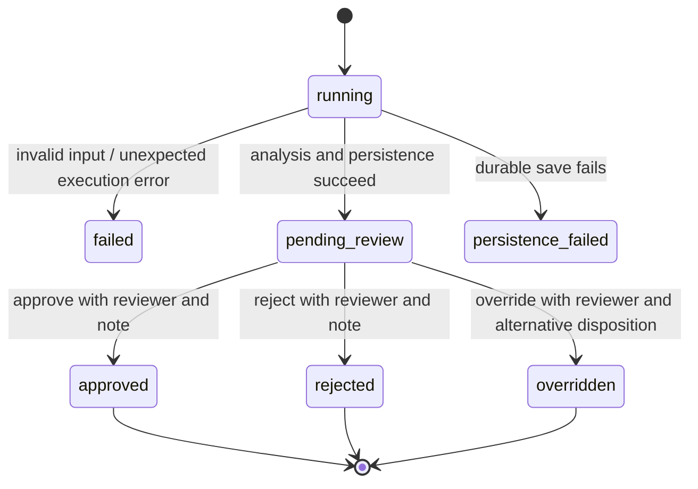

# Architecture decisions

## Design overview

The application uses a layered data flow: raw input, cleaned records, CRM-enriched context, analysis, and human review. A shared session connects the agents, while SQLite stores completed runs and review decisions. Tool interfaces separate orchestration from validation, HTTP access, analysis, and persistence.

## Flow and ownership

1. The CLI injects concrete adapters into agents and the orchestrator.
2. The orchestrator creates a unique session containing the parsed raw input.
3. The Fetcher invokes DataTool validation and CRMTool enrichment. The resulting curated object is shared within the session.
4. The orchestrator loads the latest stored summary for this client only.
5. The Analyzer invokes AnalysisTool on the curated object, producing metrics, signals, and limitations.
6. The Advisory Agent synthesizes a triage result and compares signal codes to history.
7. The orchestrator persists raw, cleaned, curated, and result in a single SQLite transaction.
8. A separate CLI command records a human decision and audit entry atomically.

Raw input is preserved as a parsed object. Cleaned data has normalized values and deduplicated transactions. Curated data joins the cleaned record with a whitelisted CRM profile. Outputs are derived from this shared foundation. Failed validation does not persist a raw record, reducing unintended retention.

## State transitions

A CRM outage changes context completeness, not the state machine. A history-read failure removes historical comparison while preserving current analysis. No transition executes a financial action. Completed reviews cannot be overwritten by another review command.

## Dependency boundaries

`DataFetcherAgent → DataTool + CRMTool`, `AnalyzerAgent → AnalysisTool`, and `Orchestrator → MemoryTool`. The Advisory Agent derives the result deterministically and records an execution event. SQLite review commands belong to the application layer, outside the analytical agents. Standard-library protocols provide replaceable adapters without a framework requirement.

## Deliberate simplifications

- One local store and in-memory session, not three cloud buckets or independent agent databases.
- Three specialist services implemented as Python objects, not separate processes.
- CLI/JSON presentation keeps results machine-readable and makes the workflow easy to exercise from scripts and tests.
- No retrieval/vector store: prior structured risk summaries need exact client lookup, not semantic search.
- No LLM or trained predictive model: no model-specific behavior or evaluation claims are made.
- CRM provides context for human suitability review. The demo does not infer suitability from portfolio concentrations alone.
- Database history uses latest execution, so backdated runs remain visible as recent analyses.

## Production evolution (not implemented)

Keep the same tool contracts while replacing SQLite with governed storage, authenticated API access and an audit service. Add schema migrations, versioned policy configuration, calibrated thresholds, idempotency keys, review authorization, encryption, retention, monitored quality metrics, and richer transaction completeness checks. If a language model is added, constrain it to explanations of validated structured results and evaluate hallucinations separately from numeric correctness.
